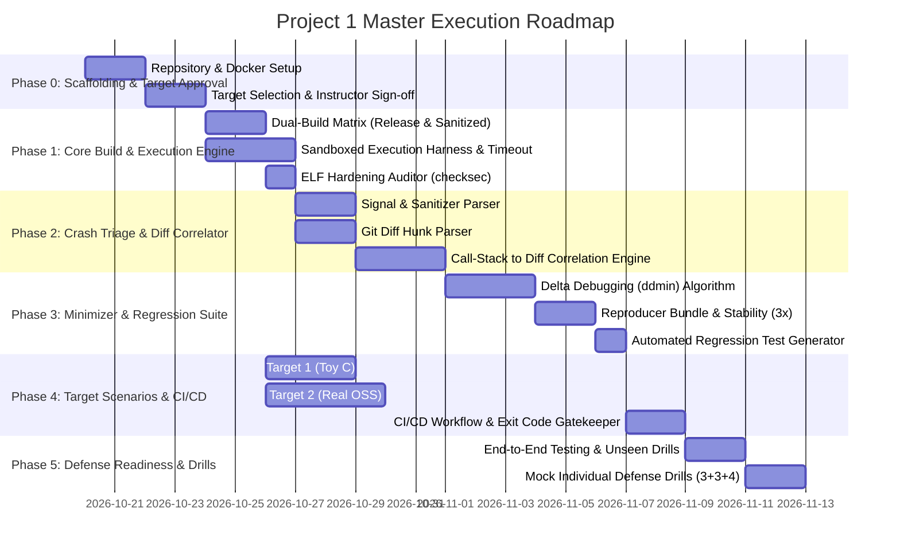

# Project 1: Actionable Implementation Roadmap & Milestone Plan

> **Course**: Data and Network Security (امنیت داده و شبکه) — Sharif University of Technology  
> **Target Project**: Automated Security Patch Validation and Regression Testing in CI/CD  
> **Execution Strategy**: 5 Phased Sprints across a 4-Engineer Team  

---

## 1. Project Master Timeline & Phase Breakdown

The project lifecycle is divided into 5 distinct sequential phases with explicit dependencies and verification gates.



---

## 2. Phase-by-Phase Action Items & Deliverables

### Phase 0: Environment Setup, Tool Scaffolding & Target Approval (Days 1–4)
*Goal: Establish repository structure, reproducible Docker sandbox, and secure instructor approval for the two targets.*

* **Step 0.1: Repository Scaffolding & CI Runner Setup**
  * Initialize the core Git repository.
  * Structure directories:
    ```text
    ├── runner/                  # Core Python/Rust/Go validation engine
    │   ├── build/              # Dual-compilation orchestrator
    │   ├── triage/             # Signal, ASan, and stack trace parsers
    │   ├── correlation/        # Diff and call-stack correlation logic
    │   ├── minimization/       # Delta debugging algorithm
    │   ├── hardening/          # ELF checksec verification
    │   └── reporter/           # JSON schema and CLI summary generators
    ├── targets/                # Target programs (Base + 3 Patched branches)
    │   ├── target1_toy/        # Standalone parser/server
    │   └── target2_oss/        # Real-world library (e.g., libpng / zlib)
    ├── configs/                # Target-specific tool_config.yaml files
    ├── docker/                 # Sandboxed execution container definitions
    └── .github/workflows/      # Automated CI/CD pipeline definition
    ```
* **Step 0.2: Dockerized Isolated Execution Environment**
  * Author `docker/Dockerfile`: Ubuntu 24.04/Debian base with `gcc`, `clang`, `gdb`, `make`, `cmake`, `patchelf`, `readelf`, and Python 3.12.
  * Configure execution resource caps: Memory constraints (`--memory=2g --memory-swap=2g`), CPU limits (`--cpus=2`), and non-root execution privileges.
* **Step 0.3: Target Selection & Instructor Approval**
  * Select Target 1: Custom standalone C parser/daemon (e.g., HTTP/JSON/Packet parser).
  * Select Target 2: Real-world OSS C library with documented CVE (e.g., `libpng` CVE-2015-8126 or `zlib` CVE-2016-9843 or `jq` CVE-2015-8863).
  * Draft the **Target Approval Document** (covering baseline CVEs, reference test sources, expected outputs) and submit to instructor Solmaz Salimi.
* **Milestone Gate 0**: Container builds reproducibly across all 4 machines; instructor signs off on selected targets.

---

### Phase 1: Dual-Build System & Sandboxed Execution Harness (Days 5–8)
*Goal: Automate parallel compilation (Release vs. Sanitized) and safe input dispatch with strict timeout controls.*

* **Step 1.1: Dual-Build Orchestration Module (`runner/build/`)**
  * Parse build instructions from `tool_config.yaml`.
  * Implement two discrete build passes per commit:
    1. **Release Mode**: `CFLAGS="-O2 -Wall"` (retains natural runtime crash behavior).
    2. **Sanitized Mode**: `CFLAGS="-O0 -g -fno-omit-frame-pointer -fsanitize=address,undefined"`.
  * Store output binaries in distinct namespaces: `bin/release/target` and `bin/sanitized/target`.
  * Assert build exit codes; if compilation fails, fail immediately with exit code `30`.
* **Step 1.2: Sandboxed Process Runner (`runner/execution/`)**
  * Implement a universal process invocation wrapper supporting all 3 POSIX input methods:
    1. `stdin`: Pipe input payloads directly into standard input.
    2. `argv`: Format command line arguments using token replacement (e.g., `{input}`).
    3. `file`: Write payload to a temporary file in `/tmp/sandbox/` and supply path as argument.
  * Implement wall-clock execution watchdog (configurable timeout, default 5.0 seconds).
  * Capture process exit code, POSIX termination signal (`SIGSEGV`, `SIGABRT`, `SIGFPE`, `SIGILL`), `stdout`, and `stderr`.
* **Step 1.3: Binary Hardening Inspector (`runner/hardening/`)**
  * Implement ELF parser inspecting release binaries using `pyelftools` or `readelf`:
    * **NX**: Check `GNU_STACK` segment flags for absence of `PF_X`.
    * **PIE**: Verify ELF type is `ET_DYN` vs `ET_EXEC`.
    * **RELRO**: Check `GNU_RELRO` segment and `DT_BIND_NOW` tag (None / Partial / Full).
    * **Stack Canary**: Check dynamic symbol table for `__stack_chk_fail`.
  * Emit hardening degradation diff between Base-Release and Patch-Release binaries.
* **Milestone Gate 1**: Both targets build automatically in both modes; process runner executes test cases with timeout enforcement; hardening auditor accurately detects stripped compiler flags.

---

### Phase 2: Crash Triage & Finding-to-Diff Correlation (Days 9–13)
*Goal: Parse crash outputs, trace call stacks, and map causal paths to git diff hunks.*

* **Step 2.1: Crash & Sanitizer Output Triage (`runner/triage/`)**
  * Implement regex/grammar parser for ASan and UBSan outputs:
    * Extract error type: `heap-buffer-overflow`, `stack-buffer-overflow`, `global-buffer-overflow`, `use-after-free`, `null-dereference`, `SEGV on unknown address`.
    * Extract shadow memory state and access address (Read vs. Write).
    * Parse full symbolized stack trace (frame index, function name, file path, line number).
  * For Release builds lacking sanitizer output:
    * Trap POSIX signal (`SIGSEGV`, `SIGABRT`).
    * If `SIGABRT` and stderr contains `*** stack smashing detected ***`, classify as `Stack Canary Failure`.
    * Spawn GDB in batch mode (`gdb -batch -ex "run" -ex "bt" --args ...`) to retrieve frame addresses.
* **Step 2.2: Git Diff Parser (`runner/correlation/diff_parser.py`)**
  * Parse unified `git diff` output into structured objects:
    * Modified file paths.
    * Line range mappings (`old_start`, `old_lines`, `new_start`, `new_lines`).
    * Function hunk identification (using `git diff -F` function regex heuristics).
* **Step 2.3: Call-Stack to Diff Correlation Engine (`runner/correlation/correlator.py`)**
  * Trace each stack frame from innermost (crash site) to outermost (entry point):
    1. **Direct Match**: Frame file and line number fall strictly within a modified hunk.
    2. **Indirect Match (Caller/Callee)**: Crash site is in an unmodified callee function, but a parent frame in the call stack exists within a modified diff hunk.
    3. **No Match / Inconclusive**: Call stack contains zero frames originating from modified diff files/functions.
  * Formulate finding state machine:
    * `Fixed`: Error triggered on Base, zero crashes on Patch across all test suites.
    * `Incomplete Fix`: Error triggered on Base; variant input crashes Patch inside the correlated subsystem.
    * `New Issue`: Clean on Base; error triggers on Patch and correlates to diff.
    * `Functional Regression`: Valid test passes on Base, fails or produces invalid output on Patch.
    * `Inconclusive`: Crash observed, but call stack cannot be correlated or reproduction is non-deterministic.
* **Milestone Gate 2**: Test suite runs against known CVE patches; tool successfully links stack traces to modified diff chunks and flags non-adjacent caller modifications.

---

### Phase 3: Automated Minimization, Reproducers & Regression Suite (Days 14–17)
*Goal: Reduce failure payloads to minimal deterministic inputs and generate reproducible test bundles.*

* **Step 3.1: Delta Debugging (`ddmin`) Implementation (`runner/minimization/`)**
  * Implement classical Delta Debugging algorithm for byte arrays and structured lines:
    1. Divide input into $n$ chunks (starting at $n = 2$).
    2. Test each chunk and its complement.
    3. If complement triggers the **exact same error invariant**, reduce input to complement and reset $n = 2$.
    4. If no chunk reduces, increase granularity $n = \min(2n, \text{len})$.
    5. Terminate when granularity cannot be increased.
  * **Strict Invariant Check**: The minimized candidate is only accepted if it reproduces the **identical error type and top stack frame** in the target binary.
* **Step 3.2: Reproducer Bundle Packager (`runner/reproducer/`)**
  * For each confirmed flaw, create an archive directory:
    ```text
    reproducers/<target>_<finding_id>/
    ├── input.raw               # Original crashing input
    ├── input.min               # Minimized crashing input
    ├── metadata.json           # Commit hash, binary SHA256, build flags, env vars
    ├── replay.sh               # Standalone reproduction script
    └── logs/                   # Logs from 3 validation replays
    ```
  * Execute `replay.sh` **3 consecutive times**. Record stability score (3/3 = Deterministic; <3/3 = Flaky / Inconclusive).
* **Step 3.3: Automated Regression Test Synthesizer (`runner/regression/`)**
  * Transform `input.min` into a target-compatible regression test case.
  * Append test definition into the target's test configuration.
  * Verify that running the regression suite confirms:
    * Assertion failure / crash on Base build.
    * Assertion success / clean exit code on Patched build.
* **Milestone Gate 3**: Large crashing input (e.g., 4096 bytes) is automatically minimized to bare minimal trigger (e.g., 18 bytes) while maintaining exact ASan error trace; reproducer replays cleanly 3 times.

---

### Phase 4: Target Benchmarks & CI/CD Pipeline Orchestration (Days 18–20)
*Goal: Finalize the 4 branch scenarios across both targets and integrate the tool into CI/CD.*

* **Step 4.1: Target 1 Construction (Custom C Parser)**
  * Branch 1: `base-vulnerable` (contains vulnerable buffer handling).
  * Branch 2: `patch-correct` (proper bounds checks, all tests pass).
  * Branch 3: `patch-incomplete` (checks only PoC length, bypassable by alternative input).
  * Branch 4: `patch-regression` (fixes flaw, but rejects valid inputs with spaces/headers).
* **Step 4.2: Target 2 Construction (Real OSS Library - e.g., `libpng`)**
  * Branch 1: `base-vulnerable` (historical CVE commit, e.g., CVE-2015-8126).
  * Branch 2: `patch-correct` (official upstream CVE fix).
  * Branch 3: `patch-incomplete` (synthetic incomplete fix that restricts only first trigger).
  * Branch 4: `patch-regression` (synthetic patch that breaks standard PNG header parsing).
* **Step 4.3: Exit Code Priority Gatekeeper & Reporting (`runner/reporter/`)**
  * Implement strict hierarchical exit code resolution:
    $$\mathbf{30} \;\succ\; \mathbf{10} \;\succ\; \mathbf{20} \;\succ\; \mathbf{40} \;\succ\; \mathbf{0}$$
  * Generate `validation_report.json` containing complete audit trails.
  * Print terminal summary table with ANSI formatting for CI logs.
* **Step 4.4: CI/CD Workflow Integration (`.github/workflows/verify_patch.yml`)**
  * Configure CI workflow triggered on Pull Requests or manual dispatch.
  * Spin up the Docker container, run the tool against target branches, verify exit codes.
* **Milestone Gate 4**: All 4 scenarios for both targets produce the exact expected exit codes (`0`, `10`, `20`) under CI/CD automation without manual intervention.

---

### Phase 5: Verification, Defense Drills & Final Polish (Days 21–Deadline)
*Goal: Ensure flawless independent defense performance and resilience against unseen defense patches.*

* **Step 5.1: Unseen Defense Patch Simulation**
  * Team members simulate defense day: create 3 secret, unseen patches for Target 1 and Target 2.
  * Execute the tool without hardcoded knowledge to verify dynamic detection and correct exit codes.
* **Step 5.2: Mock Individual Oral Defense Drills (10 Points)**
  * Conduct peer evaluation drills targeting the three oral exam axes:
    * **Axis 1 (3 pts)**: Architecture explanation and code ownership walk-through.
    * **Axis 2 (3 pts)**: Justifying a specific finding and tracing evidence from ASan report to diff hunks.
    * **Axis 3 (4 pts)**: Live coding drill — modifying a config parameter or parser heuristic and re-running live within a 5-minute timer.
* **Step 5.3: Packaging Deliverables**
  * Verify all repository deliverables: source code, Dockerfile, target branches, configs, reproducer bundles, documentation, and standalone execution guide.
* **Milestone Gate 5**: Every team member scores $\ge 8/10$ on internal mock defense and completes live code modifications successfully.

---

## 3. Team Member Allocation Matrix

| Team Member | Primary Subsystem Ownership | Key Defense Topic (3 pts) | Live Drill Topic (4 pts) |
| :--- | :--- | :--- | :--- |
| **Engineer 1** | **Build & Sandbox Harness**<br/>Dual-build pipeline, Docker container, process runner, ELF hardening checker. | Explain container isolation, ASan vs. Release build differences, and checksec segment inspection. | Add a new compiler mitigation check or modify execution timeout limits live. |
| **Engineer 2** | **Crash Triage & Correlation**<br/>Signal trap, ASan/UBSan report parsing, git diff hunk parser, stack trace mapper. | Defend how indirect (caller-callee) crashes are attributed to diff hunks; explain status classification logic. | Modify the stack frame filter regex or alter the hunk boundary threshold live. |
| **Engineer 3** | **Minimizer & Regression**<br/>Delta Debugging (ddmin), error-invariant checker, reproducer packager, stability replays. | Explain Delta Debugging algorithmic complexity and how error invariants prevent false reductions. | Change chunk division strategy or modify the replay stability pass/fail criteria live. |
| **Engineer 4** | **Targets, Reporting & CI/CD**<br/>Target 1 & 2 branch setup, test suites, exit code priority gate, JSON audit report, CI workflow. | Justify ground truth functional criteria, demonstrate all 4 branch scenarios, and explain exit code priority resolution. | Add a new test case to the test suite or reorder exit code priority live. |
