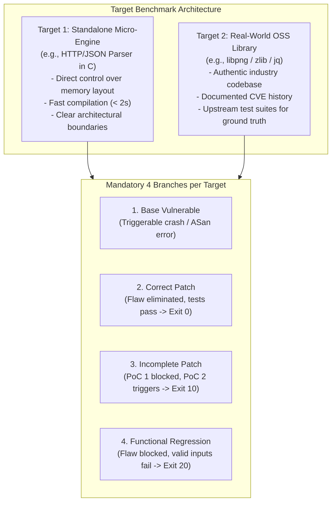
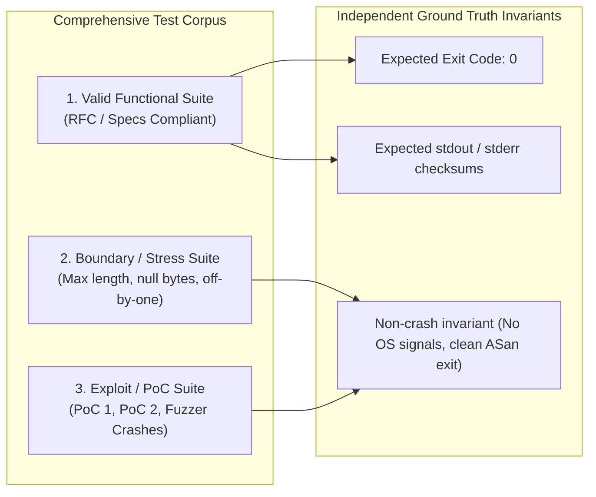

# Project 1: Target Benchmark Selection & Scenario Engineering Guide

> **Course**: Data and Network Security (امنیت داده و شبکه) — Sharif University of Technology  
> **Instructor**: Solmaz Salimi (سولماز سلیمی)  
> **Mandate**: 2 Independent C/C++ Target Programs (at least 1 real-world non-toy project) with 4 branches each  

---

## 1. Target Selection Strategy & Compliance

The course specification imposes strict constraints on target software:
1. **Compilation & Architecture**: Standalone C/C++ compilable to 64-bit Linux ELF (`x86_64`). No interpreted runtimes or web apps.
2. **I/O Modalities**: Must receive input via `stdin`, command-line arguments (`argv`), or input files.
3. **Real-World Requirement**: At least one target must be an authentic, non-toy open-source library or utility.
4. **Approval Requirement**: Targets, CVEs, test suites, and expected ground-truth behaviors must be submitted and approved by the instructor during the design phase.



---

## 2. Recommended Benchmark Selections

### 2.1. Target 1 (Standalone): `c-http-parser` / `c-json-engine`
* **Domain**: Network Protocol / Serialization Parser.
* **Input Interface**: Reads raw payload from an input file or `stdin`.
* **Vulnerability Class**: Stack/Heap Buffer Overflow in chunked body / nested token parsing.
* **Rationale**:
  * Clean, understandable codebase (500–1200 lines of C) allowing transparent demonstration during oral defense.
  * Rapid compilation allows instant iteration during the live 4-point coding modification drill.

### 2.2. Target 2 (Real-World OSS): Candidate Evaluation Matrix

| Candidate Library | Historical Vulnerability | Input Vector | Build Complexity | Defense Suitability | Recommendation |
| :--- | :--- | :---: | :---: | :---: | :--- |
| **`libpng`** (v1.6.18) | **CVE-2015-8126**<br/>Buffer overflow in `png_set_PLTE` / `png_get_PLTE` | File (`.png`) | Moderate (autotools / cmake) | High: Well-documented, clean PoCs, standard test suites available. | **Strongly Recommended** |
| **`zlib`** (v1.2.11) | **CVE-2022-37434**<br/>Heap-based buffer overflow in `inflate.c` (`inflateGetHeader`) | File / `stdin` | Low (make) | Very High: Extremely fast build, self-contained, compact code. | **Top Alternative** |
| **`jq`** (v1.5) | **CVE-2015-8863**<br/>Heap overflow in `tokenadd` via long decimal token | File / `stdin` | Moderate (autotools) | High: Rich CLI utility with diverse valid functional tests. | Good |
| **`libxml2`** (v2.9.2) | **CVE-2015-7497**<br/>Heap out-of-bounds read in `xmlDictComputeFastQKey` | File (`.xml`) | High (slow build) | Moderate: Longer compilation times slow down CI/CD loops. | Discouraged |

> **Recommended Primary Selection for Target 2**: **`zlib` (CVE-2022-37434)** or **`libpng` (CVE-2015-8126)**.  
> *`zlib` offers fast build cycles (< 3 seconds) which significantly reduces turnaround during the live defense modification task.*

---

## 3. Detailed Engineering of the 4 Branches (Per Target)

### 3.1. Target 1 Engineering Blueprint: `c-http-parser`

#### Branch 1: `base-vulnerable`
* **Vulnerable Code Pattern**:
  ```c
  void parse_header(char *raw_input) {
      char header_key[64];
      char header_val[128];
      // Vulnerability: Unchecked sscanf allows stack buffer overflow
      sscanf(raw_input, "%[^:]: %[^\r\n]", header_key, header_val);
      process_header(header_key, header_val);
  }
  ```
* **Triggering PoC-1**: An input line containing a header key of 120 bytes (`"A" * 120 + ": val\r\n"`).
* **Observed Crash**: `SIGSEGV` or `*** stack smashing detected ***` in Release build; `stack-buffer-overflow` report in ASan build.

#### Branch 2: `patch-correct`
* **Fix**: Use bounded format strings or explicit length checks:
  ```c
  void parse_header(char *raw_input) {
      char header_key[64];
      char header_val[128];
      if (sscanf(raw_input, "%63[^:]: %127[^\r\n]", header_key, header_val) == 2) {
          process_header(header_key, header_val);
      }
  }
  ```
* **Behavior**: PoC-1 and all variant malformed inputs are safely parsed or rejected. All valid HTTP headers parse successfully.
* **Expected Tool Result**: Exit Code `0` (`PASS`).

#### Branch 3: `patch-incomplete` (The Bypass Scenario)
* **Flawed Patch**: The developer assumes the overflow is only triggered by `header_val` or only checks for `'\r\n'` length:
  ```c
  void parse_header(char *raw_input) {
      char header_key[64];
      char header_val[128];
      // Naive fix: only checks total raw length, but fails on multiline or space padding
      if (strlen(raw_input) > 180) {
          return; // Supposedly blocks the 200-byte PoC
      }
      // PoC-2 bypass: header_key can still overflow with 70 bytes if total length is <= 180!
      sscanf(raw_input, "%[^:]: %[^\r\n]", header_key, header_val);
      process_header(header_key, header_val);
  }
  ```
* **PoC-2 Bypass**: An input with a 75-byte `header_key` and a 5-byte `header_val` (total length = 82 bytes $\le 180$).
* **Behavior**: Blocks PoC-1, but PoC-2 successfully triggers the stack overflow.
* **Expected Tool Result**: Exit Code `10` (`VULN_REMAINS`).

#### Branch 4: `patch-regression` (Functional Breakage)
* **Overzealous Patch**:
  ```c
  void parse_header(char *raw_input) {
      char header_key[64];
      char header_val[128];
      // Buggy sanity check: Disallows any header containing dashes or underscores
      for (int i = 0; raw_input[i]; i++) {
          if (raw_input[i] == '-' || raw_input[i] == '_') return; // Breaks standard headers!
      }
      sscanf(raw_input, "%63[^:]: %127[^\r\n]", header_key, header_val);
      process_header(header_key, header_val);
  }
  ```
* **Behavior**: Blocks memory safety crashes, but valid RFC-compliant headers like `Content-Type: text/html` or `User-Agent: curl` are dropped, causing valid functional tests to fail.
* **Expected Tool Result**: Exit Code `20` (`FUNC_REGRESSION`).

---

### 3.2. Target 2 Engineering Blueprint: `zlib` (CVE-2022-37434)

#### Vulnerability Context
* In `zlib` through 1.2.12, `inflate.c` contains a heap-based buffer overflow in `inflateGetHeader` when processing malformed gzip extra header fields.
* Input Vector: Compressed `.gz` payload file delivered via CLI argument.

#### Branch 1: `base-vulnerable`
* Checked out at tag `v1.2.12` prior to commit `1eb7682f849ac73d77` (or vulnerable checkout).
* `inflateGetHeader` allows writing past `state->head->extra` buffer when `state->head->extra_max` is smaller than the input extra field.
* **PoC-1**: A gzip stream with a crafted `0x04` header flag and an oversized extra field.
* **Crash**: ASan reports `heap-buffer-overflow` in `inflateGetHeader` in `inflate.c`.

#### Branch 2: `patch-correct`
* Incorporates official patch commit:
  ```c
  if (state->head->extra != Z_NULL) {
      len = state->head->extra_len - len;
      if (len > state->head->extra_max)
          len = state->head->extra_max;
      memcpy(state->head->extra, state->head->extra_field, len);
  }
  ```
* **Behavior**: Buffer boundaries respected. Upstream test suite (`make test`) and RFC gzip decompression tests pass completely.
* **Expected Tool Result**: Exit Code `0` (`PASS`).

#### Branch 3: `patch-incomplete`
* **Crafted Flawed Patch**: The patch checks `extra_max` only on initial entry, but fails to handle repeated chunks across multiple `inflate()` calls:
  * Blocks PoC-1 (single-buffer stream).
  * **PoC-2**: Chunked gzip input delivered in multi-part streaming mode that triggers the secondary branch of `inflateGetHeader` where the bound check was omitted.
* **Expected Tool Result**: Exit Code `10` (`VULN_REMAINS`).

#### Branch 4: `patch-regression`
* **Crafted Regression Patch**: Fixes the overflow check, but inadvertently truncates legitimate large extra fields or corrupts return codes for non-compressed valid streams:
  * Memory safety is maintained.
  * Valid decompression test for gzip files containing valid 512-byte extra metadata fails with an unhandled decompression error code.
* **Expected Tool Result**: Exit Code `20` (`FUNC_REGRESSION`).

---

## 4. Test Suite Engineering & Ground Truth Matrix

To satisfy Section 2 of the course requirements, ground truth cannot rely on the patched binary or an LLM. It must be governed by an independent reference test matrix:



### 4.1. Directory Structure for Target Test Assets
```text
targets/target1_parser/tests/
├── valid/                      # Valid functional inputs
│   ├── test_01_simple.txt      # Expected exit: 0, expected output checksum
│   ├── test_02_multiline.txt   # Expected exit: 0
│   └── test_03_standard_headers.txt
├── boundary/                   # Edge cases
│   ├── test_edge_empty.txt     # Empty payload
│   ├── test_edge_max_len.txt   # Payload exactly 63 bytes
│   └── test_edge_newlines.txt  # \n without \r
└── malicious/                  # Exploit triggers
    ├── poc1_overflow_raw.bin   # Original trigger
    └── poc2_bypass_variant.bin # Incomplete patch bypass
```

---

## 5. Formal Instructor Proposal Document (Ready for Submission)

> **Submission Template for Course Staff Approval**

```markdown
### Project 1: Target Applications and Test Proposal
**Group Members**: [Member 1], [Member 2], [Member 3], [Member 4]  
**Course**: Data and Network Security, Sharif University of Technology  

#### Target Application 1 (Micro-Target)
* **Application**: `c-http-parser` (Standalone C HTTP/1.1 Header & Request Engine).
* **Source Origin**: Open-source POSIX-compliant parser engine.
* **Vulnerability Class**: Stack-based buffer overflow in header extraction routine (`parse_header`).
* **Input Interface**: File path via argv (`./http_parser --file <path>`) and `stdin`.
* **Ground Truth Source**: RFC 7230 (HTTP/1.1 Message Syntax and Routing) test vectors.
* **Scenarios Defined**:
  - `Base`: Unchecked `sscanf` causing stack corruption on headers > 64 bytes.
  - `Correct Patch`: Bounded token copy with strict status code validation.
  - `Incomplete Patch`: Restricts total line length to 180 bytes, bypassed by crafting a short line with a disproportionate header-key length.
  - `Regression Patch`: Disallows hyphen characters (`-`), breaking valid headers such as `Content-Type`.

#### Target Application 2 (Real-World Library)
* **Application**: `zlib` (v1.2.12) / Alternative: `libpng` (v1.6.18).
* **Source Origin**: Official upstream repository (`github.com/madler/zlib`).
* **Vulnerability**: CVE-2022-37434 (Heap buffer overflow in `inflateGetHeader`).
* **Input Interface**: CLI wrapper invoking decompression on input file (`./minigzip -d <file>`).
* **Ground Truth Source**: Upstream test corpus (`test/` in zlib tree) + RFC 1952 (GZIP format specification).
* **Scenarios Defined**:
  - `Base`: Checkout at vulnerable commit exhibiting heap corruption under ASan.
  - `Correct Patch`: Upstream commit `1eb7682f849ac73d77` restricting copy bounds.
  - `Incomplete Patch`: Synthetic patch checking only non-chunked streams, bypassable via multi-part streaming chunks.
  - `Regression Patch`: Patch that truncates header metadata on valid gzip files, violating functional output equality.
```
