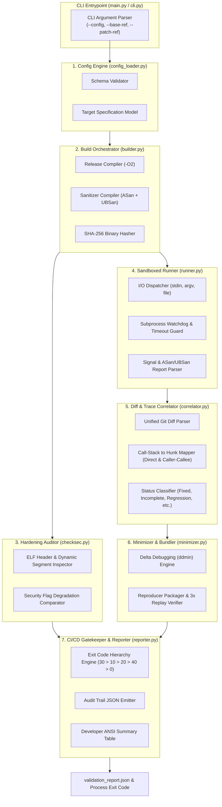

# Project 1: Technical Architecture, Algorithmic Specifications & Schemas

> **Course**: Data and Network Security (امنیت داده و شبکه) — Sharif University of Technology  
> **Topic**: Engineering Architecture, Data Contracts & Algorithmic Foundations  

---

## 1. System Module Architecture

The validation tool is architected into 7 decoupled modules, adhering to strict single-responsibility principles:



---

## 2. Configuration Schema (`tool_config.yaml`)

The tool configuration decouples the validation engine from any target-specific implementation details.

```yaml
version: "1.0"

target:
  name: "c-http-parser"
  language: "c"
  repository_path: "/workspace/targets/target1_parser"

build:
  clean_command: "make clean"
  release:
    command: "make release CFLAGS='-O2 -Wall'"
    binary_path: "bin/http_parser"
  sanitized:
    command: "make debug CFLAGS='-O0 -g -fno-omit-frame-pointer -fsanitize=address,undefined'"
    binary_path: "bin/http_parser_asan"

execution:
  timeout_seconds: 5.0
  input_method: "file"     # Options: "stdin" | "argv" | "file"
  file_argument_flag: "--file"
  fixed_arguments:
    - "--verbose"
  environment_variables:
    ASAN_OPTIONS: "detect_leaks=0:abort_on_error=1:symbolize=1"
    UBSAN_OPTIONS: "print_stacktrace=1:halt_on_error=1"

hardening_baseline:
  enforce_nx: true
  enforce_pie: true
  min_relro: "full"        # Options: "none" | "partial" | "full"
  enforce_canary: true

test_suites:
  valid_directory: "tests/valid"
  boundary_directory: "tests/boundary"
  malicious_directory: "tests/malicious"
  ground_truth:
    independent_reference_command: "python3 tests/verify_rfc_spec.py {input} {stdout} {exit_code}"
```

---

## 3. Machine-Readable JSON Report Schema (`validation_report.json`)

To comply with the requirement that the CI/CD pipeline retains all independent evidence without loss, the tool emits a structured JSON document conforming to this contract:

```json
{
  "$schema": "https://json-schema.org/draft/2020-12/schema",
  "project": "Automated Security Patch Validation",
  "timestamp": "2026-11-10T14:32:00Z",
  "target_name": "c-http-parser",
  "summary": {
    "overall_verdict": "VULN_REMAINS",
    "exit_code": 10,
    "total_tests_executed": 42,
    "functional_tests_passed": 38,
    "functional_tests_failed": 0,
    "security_flaws_fixed": 1,
    "security_flaws_lingering": 1,
    "new_security_issues": 0,
    "hardening_status": "PASSED"
  },
  "build_audit": {
    "base_commit": "a1b2c3d4e5f6...",
    "patch_commit": "b2c3d4e5f6a1...",
    "base_binary_sha256": "e3b0c44298fc1c149afbf4c8996fb92427ae41e4649b934ca495991b7852b855",
    "patch_binary_sha256": "4b227777d4dd1fc61c6f884f48641d02b4d121d3fd328cb08b5531fcacdabf8a"
  },
  "hardening_inspection": {
    "base": { "nx": true, "pie": true, "relro": "full", "canary": true },
    "patch": { "nx": true, "pie": true, "relro": "full", "canary": true },
    "degradation_detected": false,
    "warnings": []
  },
  "findings": [
    {
      "finding_id": "FINDING-001",
      "status": "Incomplete Fix",
      "error_type": "stack-buffer-overflow",
      "detection_mechanism": "AddressSanitizer",
      "triggering_input_file": "tests/malicious/poc2_bypass_variant.bin",
      "minimized_input_file": "reproducers/FINDING-001/input.min",
      "termination": {
        "exit_code": 1,
        "signal": "SIGABRT",
        "stdout": "",
        "stderr": "==1234==ERROR: AddressSanitizer: stack-buffer-overflow on address 0x7ffd534a..."
      },
      "diff_correlation": {
        "correlated": true,
        "correlation_type": "Direct Match",
        "target_file": "src/parser.c",
        "hunk_range": { "start": 42, "length": 15 },
        "matched_stack_frame": {
          "frame_index": 0,
          "function": "parse_header",
          "file": "src/parser.c",
          "line": 49
        }
      },
      "reproducibility": {
        "replayed_count": 3,
        "reproduced_count": 3,
        "is_deterministic": true
      }
    }
  ]
}
```

---

## 4. Algorithmic Specifications

### 4.1. Finding-to-Diff Correlation Algorithm
The engine must link runtime stack traces to patch modifications, handling both direct line hits and indirect caller-callee modifications.

```python
def correlate_trace_to_diff(stack_frames, git_diff_hunks):
    """
    stack_frames: List of frames ordered from inner (crash site) to outer (main).
                  Each frame has: {file: str, function: str, line: int}
    git_diff_hunks: List of modified hunks.
                    Each hunk has: {file: str, function: str, old_range: tuple, new_range: tuple}
    """
    # 1. Direct Hit: Crash site is inside a modified hunk
    crash_frame = stack_frames[0]
    for hunk in git_diff_hunks:
        if crash_frame.file == hunk.file:
            if hunk.new_range[0] <= crash_frame.line <= hunk.new_range[1]:
                return {
                    "correlated": True,
                    "correlation_type": "Direct Match",
                    "frame": crash_frame,
                    "hunk": hunk
                }

    # 2. Indirect Hit (Caller-Callee Propagation):
    # An outer caller in the stack modified a parameter or state influencing the crash
    for idx, frame in enumerate(stack_frames[1:], start=1):
        for hunk in git_diff_hunks:
            if frame.file == hunk.file:
                # Check line range or function boundary
                if hunk.new_range[0] <= frame.line <= hunk.new_range[1] or frame.function == hunk.function:
                    return {
                        "correlated": True,
                        "correlation_type": "Indirect (Caller/Callee Propagation)",
                        "caller_frame": frame,
                        "callee_crash_frame": crash_frame,
                        "hunk": hunk
                    }

    # 3. No Evidence
    return {
        "correlated": False,
        "correlation_type": "Inconclusive",
        "reason": "Call stack frames share no intersection with git diff hunks"
    }
```

---

### 4.2. Invariant-Preserving Delta Debugging (`ddmin`)
Minimizing crashing test cases without losing the root error type:

```python
def ddmin_minimize(initial_payload, execution_oracle, target_invariant):
    """
    initial_payload: bytes of the raw crashing testcase.
    execution_oracle: Callable(bytes) -> {error_type: str, crash_function: str}
    target_invariant: Tuple(expected_error_type, expected_crash_function)
    """
    def check_preserves_invariant(candidate_bytes):
        result = execution_oracle(candidate_bytes)
        # Strict Invariant Preservation: Non-zero exit code is NOT sufficient!
        return (result.error_type == target_invariant.expected_error_type and
                result.crash_function == target_invariant.expected_crash_function)

    payload = initial_payload
    n = 2  # Initial granularity

    while len(payload) >= 2:
        chunk_size = len(payload) // n
        subsets = [payload[i * chunk_size : (i + 1) * chunk_size] for i in range(n)]
        complements = [payload[:i * chunk_size] + payload[(i + 1) * chunk_size:] for i in range(n)]
        reduced = False

        # Phase A: Test individual chunks
        for chunk in subsets:
            if len(chunk) > 0 and check_preserves_invariant(chunk):
                payload = chunk
                n = 2
                reduced = True
                break

        if reduced:
            continue

        # Phase B: Test complements (removing one chunk at a time)
        for comp in complements:
            if len(comp) > 0 and check_preserves_invariant(comp):
                payload = comp
                n = max(n - 1, 2)
                reduced = True
                break

        if reduced:
            continue

        # Phase C: Increase granularity if no reduction achieved
        if n == len(payload):
            break
        n = min(n * 2, len(payload))

    return payload
```

---

### 4.3. ELF Binary Hardening Audit (`checksec.py`)
Direct inspection of ELF security bits:

```python
def audit_elf_hardening(elf_path):
    """
    Inspects ELF headers and dynamic symbols using standard ELF structures.
    """
    status = {"nx": False, "pie": False, "relro": "none", "canary": False}
    with open(elf_path, "rb") as f:
        elf = ELFFile(f)
        
        # 1. Inspect GNU_STACK for NX
        for seg in elf.iter_segments():
            if seg["p_type"] == "PT_GNU_STACK":
                # If PF_X (0x1) is NOT set, NX is active
                status["nx"] = (seg["p_flags"] & 0x1) == 0

        # 2. Inspect ELF Type for PIE
        status["pie"] = (elf.header["e_type"] == "ET_DYN")

        # 3. Inspect RELRO
        has_gnu_relro = any(s["p_type"] == "PT_GNU_RELRO" for s in elf.iter_segments())
        dynamic_section = elf.get_section_by_name(".dynamic")
        bind_now = False
        if dynamic_section:
            for tag in dynamic_section.iter_tags():
                if tag.entry.d_tag in ("DT_BIND_NOW", "DT_FLAGS") and (tag.entry.d_val & 0x8):
                    bind_now = True

        if has_gnu_relro and bind_now:
            status["relro"] = "full"
        elif has_gnu_relro:
            status["relro"] = "partial"
        else:
            status["relro"] = "none"

        # 4. Inspect Stack Canary (__stack_chk_fail symbol)
        symtab = elf.get_section_by_name(".dynsym") or elf.get_section_by_name(".symtab")
        if symtab:
            status["canary"] = any(sym.name == "__stack_chk_fail" for sym in symtab.iter_symbols())

    return status
```

---

### 4.4. CI/CD Exit Code Priority Gatekeeper

```python
def resolve_exit_code(build_failed, vuln_remains_or_new, func_regression, is_inconclusive):
    """
    Deterministic resolution hierarchy:
    30 (BUILD_ERROR) > 10 (VULN_REMAINS/NEW_ISSUE) > 20 (FUNC_REGRESSION) > 40 (INCONCLUSIVE) > 0 (PASS)
    """
    if build_failed:
        return 30, "ERROR_CONFIG_OR_BUILD"
    if vuln_remains_or_new:
        return 10, "VULN_REMAINS_OR_NEW_ISSUE"
    if func_regression:
        return 20, "FUNC_REGRESSION"
    if is_inconclusive:
        return 40, "INCONCLUSIVE"
    return 0, "PASS"
```
