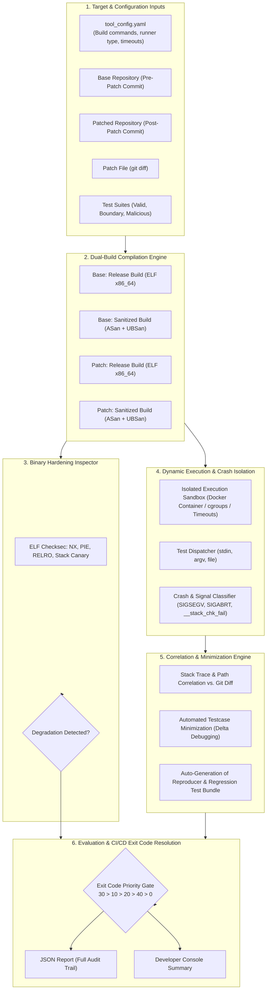
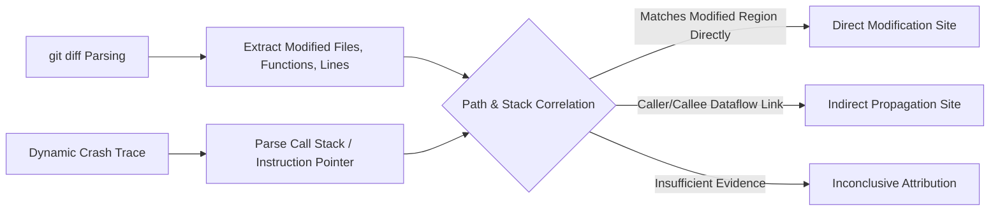
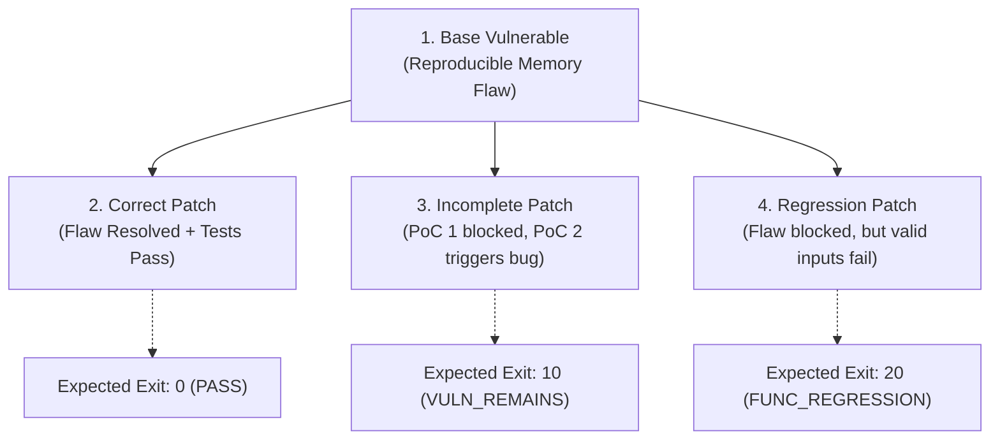
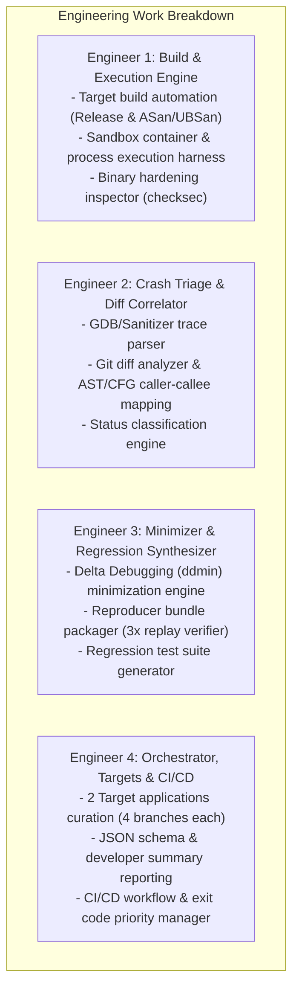

# Project 1: Automated Security Patch Validation and Regression Testing in CI/CD

> **Course**: Data and Network Security (امنیت داده و شبکه)  
> **Institution**: Sharif University of Technology – Department of Computer Engineering  
> **Instructor**: Solmaz Salimi (سولماز سلیمی)  
> **Timeline**: Released: 28 Mehr 1405 | Due: 18 Aban 1405  
> **Format**: Groups of 4 students  
> **Grading Weight**: 2.5 / 20.0 points of total course grade  

---

## 1. Executive Summary & Core Mission

When software vendors release security patches, applying the patch does not guarantee that the security vulnerability is eliminated without adverse side effects:
1. **Incomplete Patches**: A patch may only block a specific proof-of-concept (PoC) exploit input while leaving the root vulnerability accessible through alternative inputs or bypasses.
2. **Functional Regressions**: A patch may alter program control flow, invariants, or state machines in a manner that breaks expected, legitimate functionality.

The mission of this project is to architect and implement an **automated dynamic testing and patch validation engine integrated into a CI/CD pipeline**. The tool must move beyond static scanning or naive diff heuristics by actively executing target binaries to resolve two deterministic questions:
1. **Security Invariant**: Does the original vulnerability (reproduced in the pre-patch baseline) persist or morph in the patched version across the defined test suite?
2. **Functional Invariant**: Does the patched version maintain strict operational correctness and backward compatibility across all valid and boundary inputs?

The tool must deterministically correlate observed crashes and behaviors to exact patch changes (`git diff`), isolate production artifacts from diagnostic builds, minimize failure-inducing inputs, and emit standardized machine-readable and developer-facing artifacts.

---

## 2. High-Level Architecture & Pipeline Flow

The engine acts as a quality gate inside a CI/CD pipeline (e.g., GitHub Actions, GitLab CI, or a containerized runner). It consumes a pre-patch commit, a post-patch commit, patch diffs, and test suites, executing them through a dual-build matrix before emitting standardized exit codes.

---

## 3. Scope of Support & Operational Constraints

### 3.1. Target Software Scope
* **Language Ecosystem**: Native C or C++ projects compilable to standalone **ELF x86_64** executables for Linux.
* **Prohibited Targets**: Interpreted scripts (Python, Ruby), web applications, or managed runtimes cannot serve as targets. (The validation tool itself can be written in any language, such as Python, Rust, Go, or C++).
* **I/O Channel Support**: The tool must orchestrate inputs across all three standard POSIX delivery channels:
  1. Standard Input (`stdin`)
  2. Command-Line Arguments (`argv`)
  3. Input Files (passed via path arguments or flags)
* **Build Reproducibility**: Both base and patched variants must provide compilable source trees.
* **Generalizability**: No hardcoded symbols, function names, file paths, or target-specific heuristics. Onboarding a new software target must require solely updating a configuration file (specifying build command, binary path, execution syntax, and test directories).

### 3.2. Ground Truth for Functional Correctness
* Functional correctness criteria cannot be established by the output of the patched binary itself, nor can it be inferred by querying an LLM.
* Expected outputs, status codes, and invariant behaviors must be derived from **independent reference documentation**, upstream formal specifications, or baseline reference tests pre-approved by the instructor.

---

## 4. Detailed Functional Specifications

### 4.1. Patch Correlation & Finding-to-Diff Mapping (Core Engine)
The core algorithmic requirement is linking dynamic runtime behavior directly to the syntactic and semantic changes in the patch (`git diff`).

* **Correlation Methodology**:
  * Parse the unified `git diff` into modified files, altered function boundaries (hunks), and changed line ranges.
  * When a crash occurs, parse the stack trace (via GDB, LLDB, or Sanitizer stack unwinding) and execution path.
  * Map frames in the call stack to the diff.
  * **Critical Rule**: A bug does not necessarily crash on the exact line modified. For instance, modifying a buffer length check in a caller function may trigger an out-of-bounds write in a callee function. The engine must track caller-callee relationships rather than relying on naive line adjacency.
  * If the causal link between the patch and the error cannot be substantiated by stack traces or execution flow, the finding must be formally marked as `Inconclusive`.
* **Classification Taxonomy**:
  * `Fixed`: Vulnerability reproduced on the base version, but completely absent on the patched version across all test cases.
  * `Incomplete Fix`: The specific baseline PoC input is neutralized, but variant inputs continue to exploit the vulnerability within the modified subsystem.
  * `New Issue`: A crash or memory corruption occurs on the patched version that was not present in the baseline.
  * `Functional Regression`: Valid inputs that successfully executed on the baseline produce incorrect outputs, invalid exit codes, or unexpected termination on the patched build.
  * `Inconclusive`: Ambiguous data, non-deterministic reproduction, or unclassified abnormal termination.

---

### 4.2. Dynamic Testing, Build Matrix & Crash Triage

#### 4.2.1. Dual-Build Compilation Matrix
To prevent false equivalences between release binaries and diagnostic builds, testing must be executed in parallel across two distinct build modes:
1. **Release Build (`Release Build`)**: Compiled with production optimizations (e.g., `-O2`) and standard hardening. This observes real-world crash manifestations and user-facing behavior.
2. **Sanitized/Instrumented Build (`Sanitized Build`)**: Compiled with AddressSanitizer (`-fsanitize=address`) and UndefinedBehaviorSanitizer (`-fsanitize=undefined`) and debug symbols (`-g -fno-omit-frame-pointer`). This provides exact memory metadata, shadow byte analysis, and root-cause localization.

> [!IMPORTANT]
> Results from release builds and sanitized builds must **never** be conflated. Pre-patch and post-patch evaluations must only be compared across matching configurations: Base-Release vs. Patch-Release, and Base-Sanitized vs. Patch-Sanitized.

#### 4.2.2. Error Taxonomy & Detection Mechanisms
When a crash or fault occurs, the triage engine must record:
* **Error Classification**:
  * Stack Buffer Overflow
  * Heap Buffer Overflow
  * Use-After-Free (UAF) / Double Free
  * Null Pointer Dereference
  * Integer Overflow / Division by Zero
  * Out-of-bounds Read/Write
* **Detection Mechanism**:
  * OS Signal Trapping (e.g., `SIGSEGV`, `SIGBUS`, `SIGFPE`, `SIGILL`)
  * Runtime Canary Guard (`__stack_chk_fail` triggering `SIGABRT`)
  * Compiler Sanitizer Trap (ASan/UBSan report output)
* **Termination Attributes**:
  * Process exit code
  * Terminating signal
  * Complete capture of `stdout` and `stderr`
  * Resource / Timeout limits exceeded (Timeouts must be classified separately from memory safety crashes).

---

### 4.3. Reproducibility, Testcase Minimization & Regression Generation

#### 4.3.1. Reproducer Bundle
For every verified vulnerability or crash, the tool must package a standalone, self-contained reproducer bundle comprising:
* Exact raw triggering payload / input file.
* Target Git commit hash and binary SHA-256 hash.
* Full compiler flags and environment variables (`ASAN_OPTIONS`, locale, etc.).
* Exact invocation CLI string (including flags, redirection, and environment setup).
* Multi-run stability validation: Execute the reproducer a minimum of **3 consecutive times** to determine determinism and explicitly flag flaky findings.

#### 4.3.2. Automated Testcase Minimization (Delta Debugging)
* Raw inputs (e.g., large fuzzing corpora, generated blobs) must be minimized automatically.
* Implementation: Algorithmic reduction such as **Delta Debugging (DDmin)** or iterative chunk/byte trimming.
* **Preservation Invariant**: The reduced input must produce the **exact same error type and stack location** as the original payload.
* A simple non-zero exit code does **not** indicate error equivalence (e.g., an input that causes early parsing failure does not preserve a downstream buffer overflow).
* Both the original and minimized inputs must be preserved in the final bundle.

#### 4.3.3. Automated Regression Test Generation
* The minimized test case must be automatically formatted and committed into the target's automated regression test suite.
* The synthesized test must assert:
  1. Failure/crash on the baseline vulnerable build.
  2. Clean execution and correct functional behavior on the patched build.

---

### 4.4. Binary Hardening Baseline Verification
The tool must inspect release ELF binaries across both versions to detect unintended degradation of security protections caused by Makefile/CMake modifications:

| Security Mitigation | Inspection Target | Detection Nuance / Tool Responsibility |
| :--- | :--- | :--- |
| **NX / DEP** | `GNU_STACK` ELF header segment permissions | Verify `R W` (not `R W X`). Flag stack execution enablement. |
| **PIE** | ELF file type (`ET_DYN` vs `ET_EXEC`) | Note: Binary PIE support does not guarantee kernel ASLR is active at runtime. |
| **RELRO** | `GNU_RELRO` segment and `BIND_NOW` dynamic flag | Differentiate: **No RELRO**, **Partial RELRO**, and **Full RELRO**. |
| **Stack Canary** | Symbol inspection for `__stack_chk_fail` | Note: Symbol presence indicates compiler flag active, not 100% function coverage. |

* **Alert Trigger**: If any protection active in the baseline binary is absent or downgraded in the patched binary, emit a dedicated hardening alert.

---

### 4.5. CI/CD Orchestration & Deterministic Exit Codes

#### 4.5.1. Standard Exit Codes
The tool serves as a decisive pipeline gate. It must terminate with one of the following exact exit codes:

| Exit Code | Label | Trigger Condition |
| :---: | :--- | :--- |
| **`0`** | `PASS` | Target vulnerability reproduced on base, confirmed absent on patched within test suite; no new security flaws identified; all functional and hardening checks passed completely. |
| **`10`** | `VULN_REMAINS` / `NEW_ISSUE` | Baseline vulnerability persists in the patched build (`VULN_REMAINS`), OR a new verified memory/security flaw has been triggered (`NEW_ISSUE`). |
| **`20`** | `FUNC_REGRESSION` | At least one valid functional test that passed on the base build fails on the patched build (independent of security status). |
| **`30`** | `ERROR_CONFIG_OR_BUILD` | Target fails to compile, configuration file is malformed, environment dependency is missing, or the tool crashes. |
| **`40`** | `INCONCLUSIVE` | Required checks could not be completed, baseline flaw failed to reproduce, execution was non-deterministic/flaky, or crash is unclassified. |

#### 4.5.2. Conflict Resolution Priority Matrix
When multiple conditions occur concurrently, exit codes must be evaluated under the following strict priority hierarchy:

$$\mathbf{30} \;\succ\; \mathbf{10} \;\succ\; \mathbf{20} \;\succ\; \mathbf{40} \;\succ\; \mathbf{0}$$

> **Example**: If a patch successfully fixes the security vulnerability (`0`), but breaks a functional test (`20`), the engine exits with code `20`. If an incomplete fix persists (`10`) and a functional regression also occurs (`20`), code `10` takes precedence.

Regardless of the selected process exit code, the emitted **JSON report must preserve all discrete statuses, findings, and evidence in full detail**.

---

## 5. Target Benchmark Programs & Evaluation Scenarios

The project must be verified and delivered across **two distinct C/C++ target software packages**:
* **Real-World Requirement**: At least **one** target must be a real-world, non-toy open-source software project or library (e.g., `libpng`, `libxml2`, `zlib`, `curl`, `tcpdump`, `sqlite`).
* Public CVEs, existing regression tests, and known vulnerability disclosures may be used (zero-day discovery is not required).

### 5.1. The Four Mandatory Test Scenarios per Target
For each of the two selected targets, four specific branches/commits must exist in the repository:

1. **Base Vulnerable (`Base Vulnerable`)**:
   * Contains at least one reproducible memory safety flaw.
2. **Correct Patch (`Correct Patch`)**:
   * Flaw is neutralized under all test inputs.
   * All functional regression tests pass.
   * **Expected Tool Output**: Exit Code `0`.
3. **Incomplete Patch (`Incomplete Patch`)**:
   * Blocks the original PoC input (e.g., checks `if (len == 100)`), but fails to address the root vulnerability, allowing an alternative input crafted by the team to bypass the check and trigger the flaw.
   * **Expected Tool Output**: Exit Code `10`.
4. **Regression Patch (`Regression Patch`)**:
   * Eliminates the security vulnerability, but disrupts normal program logic, causing at least one valid functional test to fail.
   * **Expected Tool Output**: Exit Code `20`.

### 5.2. Live Defense "Unseen Patches" Evaluation
During oral defense sessions, the course staff will supply **unseen patches** for the chosen target or an architecturally related application via the agreed-upon interface.
* The tool will be executed live in an isolated container.
* Hardcoding repository commit IDs, file names, or patch hashes will result in immediate disqualification.

---

## 6. Execution Sandbox & Isolation Architecture

To ensure deterministic evaluation and host security, all compilation and test execution must occur within an isolated containerized environment:
* **Container Isolation**: Docker/OCI container running an x86_64 Linux distribution.
* **Resource Constraints**:
  * Memory limits (e.g., `--memory="2g"` with swap disabled).
  * CPU execution caps (e.g., `--cpus="2"`).
  * Strict execution timeouts per testcase (e.g., 5-second per-test timeout via `timeout` or sub-process monitors) to prevent denial-of-service hanging from infinite loops.
* **Security & Non-Interference**: Execution of potentially malicious payloads must not escape the container or alter the host environment.

---

## 7. Grading Scheme & Evaluation Rubric

### 7.1. Technical Evaluation Rubric (100 Group Points)

| Evaluation Component | Maximum Points | Verification Criteria |
| :--- | :---: | :--- |
| **Patch Validation & Diff Correlation** | **25** | Depth of trace correlation to diff; identification of non-adjacent call sites; accurate status categorization (`Fixed`, `Incomplete Fix`, `New Issue`, `Functional Regression`, `Inconclusive`). |
| **Dynamic Execution & Error Triage** | **25** | Execution of valid, boundary, and malicious suites; rigorous separation of Release vs. Sanitized builds; detailed crash taxonomy and detection mechanism logging. |
| **Reproducibility, Minimization & Regression** | **15** | Completeness of reproducer bundles (3x replay stability); algorithmic minimization (Delta Debugging) preserving error type; automatic synthesis of regression test. |
| **Target Implementations & Unseen Patches** | **15** | Flawless demonstration across 2 targets (at least 1 real-world non-toy) covering all 4 patch scenarios; robust handling of live unseen defense patches. |
| **CI/CD Integration & Standard Exit Codes** | **10** | Seamless CLI execution; machine-readable JSON schema; comprehensive human summary; strict adherence to exit code hierarchy (`30 > 10 > 20 > 40 > 0`). |
| **Binary Hardening Inspection** | **5** | Accurate detection of ELF protections (NX, PIE, RELRO levels, Stack Canary) and alerting on regression/degradation. |
| **Documentation, Architecture & Modularity** | **5** | Clean modular codebase; comprehensive standalone documentation; clear setup and reproducibility instructions. |
| **Total Technical Score** | **100** | |

### 7.2. Individual Defense Assessment & Grading Formula
* The individual defense is scored out of **10 points** across three strict criteria:
  1. **Architecture & Logic (3 points)**: Explaining overall architecture, system design, and the specific module implemented by the student.
  2. **Finding Analysis & Justification (3 points)**: Analyzing a specific test output, explaining the evidence trail, and defending the engine's classification.
  3. **Live Code/Config Modification (4 points)**: Implementing a scoped code modification or configuration change live during defense and verifying the outcome via test runs.
* **Passing Gate Requirement**:
  * To receive credit for the project, each student must:
    1. Demonstrate verified active contribution.
    2. Score **$\ge$ 5 / 10** on the individual defense.
    3. Score **$\ge$ 1 point** in each of the three defense axes.
  * *Failure to satisfy these conditions results in a project score of **0** for that member, regardless of group score.*

$$\text{Individual Final Score} = 2.5 \times \left(\frac{\text{Group Technical Score}}{100}\right) \times \left(\frac{\text{Individual Defense Score}}{10}\right)$$

---

## 8. Strategic Work Breakdown Structure (Team of 4)

To ensure every member possesses verifiable ownership of a core subsystem for the individual defense, the project maps naturally to 4 engineering roles:

1. **Engineer 1: Build Pipeline & Execution Harness**:
   * Implements the dual-build compilation orchestrator (Release + ASan/UBSan).
   * Manages container isolation, resource caps, and timeout guards.
   * Develops the ELF hardening inspection engine (NX, PIE, RELRO, Stack Canary).
2. **Engineer 2: Crash Triage & Finding-to-Diff Correlator**:
   * Implements signal trapping, sanitizer report parsing, and termination classification.
   * Authors the finding-to-patch correlation engine linking call stacks to `git diff` hunks.
   * Handles the classification state machine (`Fixed`, `Incomplete Fix`, `New Issue`, `Functional Regression`, `Inconclusive`).
3. **Engineer 3: Testcase Minimizer & Regression Engine**:
   * Implements automated testcase minimization (Delta Debugging algorithm).
   * Ensures error-type preservation during minimization.
   * Packages reproducer bundles (multi-run replay stability) and generates automated regression tests.
4. **Engineer 4: Target Benchmarks, CI/CD & Reporting**:
   * Selects and configures the two target C/C++ applications (1 real-world library).
   * Authors the 4 target branches per program (Vulnerable Base, Correct, Incomplete, Regression).
   * Implements the unified CLI, JSON audit reporting, developer summaries, and CI/CD exit code gatekeeper.
